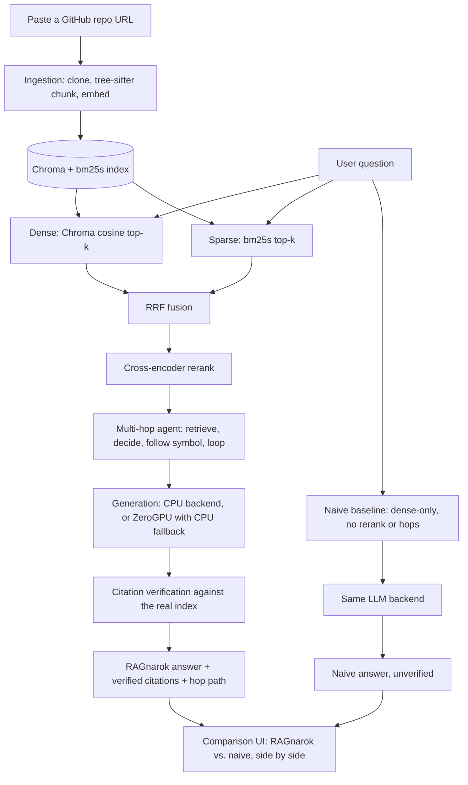

# RAGnarok

A RAG assistant for understanding codebases. Paste a public GitHub repo URL,
ask a natural-language question, and get an answer grounded in the actual
code — with verified `file#Lstart-Lend` citations and multi-hop tracing
across files. Every question also runs through a naive single-vector
baseline so the value of hybrid retrieval + reranking + multi-hop is shown
side by side, live, on the same query.

See [`docs/roadmap.md`](docs/roadmap.md) for the phase-by-phase build plan
and [`docs/architecture.md`](docs/architecture.md) for the current design.

## Architecture



## Status

Phases 1-9 are code-complete (see [`docs/roadmap.md`](docs/roadmap.md) for
exact per-phase status):

- Several phases (3, 4, 5, 6, 7) have real-model-inference steps
  (comparison runs, eval scoring) that were deliberately not executed in
  the development session that wrote this code, to avoid CPU load on the
  author's machine — the code paths are fully unit-tested with real
  models mocked out, but the "does it actually beat the naive baseline in
  practice" numbers below are not yet filled in.
- The live public HF Space has not been deployed yet (Phase 8) and the
  incremental-reindex CI job has never been dispatched (Phase 9) — both
  need an HF namespace/token decision that hasn't been made yet.

**Eval numbers and ablation table:** pending a real run of
`scripts/run_eval.py --ablation` against a built `encode/starlette` index.
No placeholder numbers are shown here — they'll be filled in once that run
happens, sourced directly from its output, not invented.

**Demo GIF:** pending a real deployed instance to record from.

## Third-party models

| Model                                                                                                 | Used for                                 | License    |
| ----------------------------------------------------------------------------------------------------- | ---------------------------------------- | ---------- |
| [`jinaai/jina-embeddings-v2-base-code`](https://huggingface.co/jinaai/jina-embeddings-v2-base-code)   | Dense embeddings (ingestion + retrieval) | Apache 2.0 |
| [`cross-encoder/ms-marco-MiniLM-L-6-v2`](https://huggingface.co/cross-encoder/ms-marco-MiniLM-L-6-v2) | Cross-encoder reranking                  | Apache 2.0 |
| [`Qwen/Qwen2.5-Coder-3B-Instruct-GGUF`](https://huggingface.co/Qwen/Qwen2.5-Coder-3B-Instruct-GGUF)   | CPU generation backend                   | Apache 2.0 |
| [`Qwen/Qwen2.5-Coder-7B-Instruct`](https://huggingface.co/Qwen/Qwen2.5-Coder-7B-Instruct)             | ZeroGPU generation backend               | Apache 2.0 |

Every model load in `src/` pins an exact commit `revision`, so none of
these can silently change underneath the app.

## Local development

`pyproject.toml` declares the project's direct runtime dependencies, so a
plain editable install works standalone:

```bash
pip install -e ".[dev]"
pytest -q
python app.py
```

For an exact reproduction of the pinned, fully-resolved environment this
was tested against (including transitive pins), use the frozen lock file
instead:

```bash
pip install -e .
pip install -r requirements.txt
```

`llama-cpp-python` ships a prebuilt CPU wheel for Linux from a custom
index; on Linux (e.g. HF Spaces), pass
`--extra-index-url https://abetlen.github.io/llama-cpp-python/whl/cpu`
to either install command, or it will build from source. macOS arm64
always builds from source (the prebuilt wheel index is broken for that
platform).

### Quality gates

```bash
ruff check .
ruff format --check .
mypy
pytest -q --cov --cov-report=term-missing
```

All four run in CI (`.github/workflows/ci.yml`) on every push and pull request.
