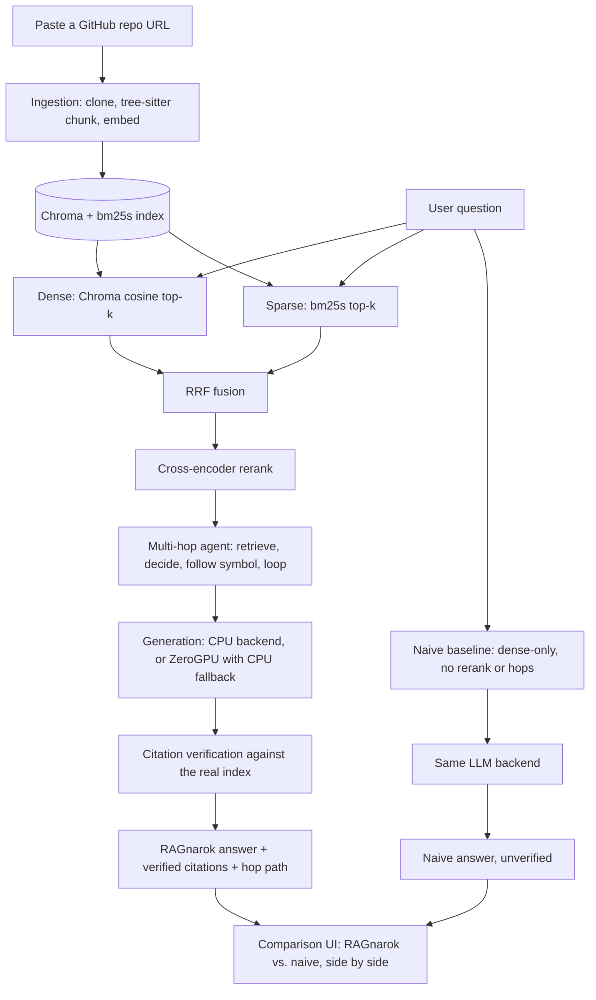

# RAGnarok

A RAG assistant for understanding codebases. Paste a public GitHub repo URL,
ask a natural-language question, and get an answer grounded in the actual
code — with verified `file#Lstart-Lend` citations and multi-hop tracing
across files. Every question also runs through a naive single-vector
baseline so the value of hybrid retrieval + reranking + multi-hop is shown
side by side, live, on the same query.

Fixed demo/eval repo: **`encode/starlette`**.

## Architecture



## How it works

1. **Ingestion** (`src/ingestion/`) — shallow-clones the repo, parses source with `tree-sitter`
   (Python, JS/TS, Go, Rust, Java, C/C++; YAML/JSON/TOML fall back to whole-file chunking),
   chunks along function/class boundaries, embeds each chunk, and indexes into Chroma (dense)
   + `bm25s` (sparse). Every chunk carries the exact commit `repo_sha` it came from and, for
   definition chunks, the file's own top-level imports (shown to the model in the prompt so
   an isolated function still resolves names like `Request` to the right module — excluded
   from the embedded/reranked text itself so it can't dilute retrieval matching). Real caps
   guard against pathological inputs: a per-file size cap, a total-source-bytes cap, a
   total-chunk-count cap (surfaced to the user if hit, not silent), and a whole-file chunk is
   bounded by both line count and character count (so a single giant minified line still gets
   split).
2. **Retrieval** (`src/retrieval/`) — dense (Chroma cosine) and sparse (`bm25s`) results are
   fused via Reciprocal Rank Fusion, then reordered by a cross-encoder reranker before
   anything reaches the LLM.
3. **Multi-hop agent** (`src/agent/`) — a LangGraph state machine: `retrieve → decide_more_hops
   → follow_symbol → compose_answer`, looping until the model declines another hop or a hop
   budget (`AGENT_MAX_HOPS`) is exhausted. The hop-decision model replies with both a symbol
   name (or `DONE`) and a short reason, so `HopRecord.reason` reflects real justification
   instead of a fixed template, and hop-decision prompts/replies are logged for debugging.
   Tool-call failures (a retrieval/lookup error) degrade to an empty result instead of
   crashing the whole request.
4. **Generation** (`src/generation/`) — a `ZeroGPUBackend` (primary) with automatic fallback
   to a CPU `llama-cpp-python` backend on quota-exceeded or when ZeroGPU hardware isn't
   available (e.g. local dev). Context is trimmed to fit whichever backend's real token
   budget applies before rendering the prompt, and a relevance guardrail answers "not covered
   by this repo" without calling the model at all when nothing retrieved clears a minimum
   score.
5. **Citation verification** (`src/generation/citations.py`) — every `file#Lstart-Lend` span
   the model outputs is checked against the real index; unverified citations are flagged, not
   hidden.
6. **Comparison mode** (`src/pipeline.py`, `src/ui/`) — a two-tab Gradio app: Compare (naive
   vs. full RAGnarok, side by side) and Ingest (paste any public GitHub repo URL to index it).
   Both tabs share one "active repo" state, so ingesting a new repo actually changes what
   Compare answers about; an `LRUCache` (capacity `MAX_RESIDENT_REPOS`) keeps more than one
   repo's models resident at once instead of reloading on every question.
7. **Evaluation** (`src/eval/`, `data/eval/qa_starlette.jsonl`) — a 35-item hand-labeled set
   (20 single-hop, 10 multi-hop, 5 adversarial "not in this repo" items) scored with RAGAS
   (faithfulness, context precision/recall, using the app's own generation backend as judge)
   plus a 3-arm ablation (naive / hybrid+rerank / full multi-hop). See "Status" below for
   whether real numbers exist yet.
8. **Incremental indexing** (`.github/workflows/reindex.yml`) — a daily job re-chunks/re-embeds
   only files changed since the last indexed commit, rejecting (not silently merging) an index
   whose embedding model/schema no longer matches current config. `app.py` pulls the latest
   CI-pushed index at startup when `HF_DATASET_REPO` is configured.

## Key technology choices

| Concern | Choice | Why |
|---|---|---|
| Vector store | Chroma | Needs metadata + `where`-filtering anyway; a bare index blob isn't enough |
| Sparse retrieval | `bm25s` | 100-500x faster than `rank-bm25`; matters for live per-repo indexing |
| Parsing | `tree-sitter` + `tree-sitter-language-pack` | MIT, vetted permissive grammars, zero manual grammar builds |
| UI | Gradio Blocks | `@spaces.GPU`/ZeroGPU is exclusively Gradio-compatible |
| Judge model (eval) | The app's own hosted model, via a custom `BaseRagasLLM` | Avoids a paid external judge API |
| Repo cloning | plain `git` via `subprocess` | GitPython shells out to `git` anyway for this project's narrow needs |

## Operational notes

- **ZeroGPU free quota**: 5 min/day per account (2 min unauthenticated, 40 min PRO, 60 min
  Enterprise — verified against `huggingface.co/docs/hub/en/spaces-zerogpu`, 2026-07-24;
  recheck periodically, HF has changed this before), shared/queued across every visitor. A
  bigger generation model burns that shared daily budget faster for everyone, not just its
  own requests — that tradeoff, not local VRAM, is the real constraint on model size here.
- **`llama-cpp-python`** needs its prebuilt CPU wheel (`requirements.txt`'s
  `--extra-index-url`) to install in time on HF Spaces' free build environment — see "Local
  development" below.
- **Free CPU Spaces (2 vCPU/16GB RAM)**: ingestion has hard caps (`MAX_INDEXABLE_CHUNKS`,
  `MAX_SOURCE_BYTES`) surfaced to the user if hit, and the `LRUCache` bounds how many repos'
  models stay resident at once (`MAX_RESIDENT_REPOS`).

## Status

**Updated 2026-07-25.** Core pipeline (ingestion → hybrid retrieval/rerank → multi-hop agent
→ generation with ZeroGPU-primary/CPU-fallback → citation verification → naive-vs-RAGnarok
comparison UI) is implemented, unit-tested (391 tests, 97% coverage), and manually verified
end-to-end against real models on the demo repo. Ruff and mypy are both clean project-wide.

Not yet done:

- **No live HF Space deployed yet** — `HF_TOKEN`/`HF_DATASET_REPO` aren't configured anywhere,
  so the daily incremental-reindex GitHub Action has never actually run against a live Dataset
  repo, and there's no real per-query ZeroGPU-quota consumption data to size the generation
  model against.
- **No real eval numbers yet** — `scripts/run_eval.py --ablation` against a built
  `encode/starlette` index has never been run in this environment. No placeholder numbers are
  shown anywhere in this repo; they'll be filled in once that run happens, sourced directly
  from its output.
- **Demo GIF** — pending a real deployed instance to record from.

## Third-party models

| Model                                                                                                 | Used for                                 | License    |
| ----------------------------------------------------------------------------------------------------- | ---------------------------------------- | ---------- |
| [`Qwen/Qwen3-Embedding-4B`](https://huggingface.co/Qwen/Qwen3-Embedding-4B)                           | Dense embeddings (ingestion + retrieval) | Apache 2.0 |
| [`Qwen/Qwen3-Reranker-0.6B`](https://huggingface.co/Qwen/Qwen3-Reranker-0.6B)                         | Cross-encoder reranking                  | Apache 2.0 |
| [`Qwen/Qwen2.5-Coder-3B-Instruct-GGUF`](https://huggingface.co/Qwen/Qwen2.5-Coder-3B-Instruct-GGUF)   | CPU generation backend                   | Apache 2.0 |
| [`Qwen/Qwen2.5-Coder-7B-Instruct`](https://huggingface.co/Qwen/Qwen2.5-Coder-7B-Instruct)             | ZeroGPU generation backend               | Apache 2.0 |

Every model load in `src/` pins an exact commit `revision`, so none of these can silently
change underneath the app.

**2026-07-25: the embedding and reranker models were upgraded** (from
`jinaai/jina-embeddings-v2-base-code` and `cross-encoder/ms-marco-MiniLM-L-6-v2` to the Qwen3
models above). This makes every existing on-disk index incompatible
(`IndexManifest.has_compatible_embedding_setup()` correctly rejects it) — any index, including
the local demo cache, must be rebuilt from scratch before the app will answer questions again:

```bash
python -m scripts.build_index https://github.com/encode/starlette --rebuild
```

## Local development

`pyproject.toml` declares the project's direct runtime dependencies, so a
plain editable install works standalone:

```bash
pip install -e ".[dev]"
pytest -q
python app.py
```

For an exact reproduction of the pinned, fully-resolved environment this
was tested against (including transitive pins), use the frozen lock file
instead:

```bash
pip install -e .
pip install -r requirements.txt
```

`llama-cpp-python` ships a prebuilt CPU wheel for Linux from a custom
index; on Linux (e.g. HF Spaces), pass
`--extra-index-url https://abetlen.github.io/llama-cpp-python/whl/cpu`
to either install command, or it will build from source. macOS arm64
always builds from source (the prebuilt wheel index is broken for that
platform). Standard `pyproject.toml` dependency declarations have no field
for a per-package index URL, so `pip install -e .`/`-e ".[dev]"` alone
**always** falls back to a from-source build regardless of platform —
`requirements.txt` (the file HF Spaces itself installs from) is the only
one of the two that's self-sufficient on Linux, since it carries the
`--extra-index-url` line directly.

### Running the eval harness

```bash
python -m scripts.run_eval .ragnarok_cache/encode/starlette --ablation
```

Requires a built index for the target repo (`scripts/build_index.py` first) and real
embedding/rerank/generation model inference — not run automatically by CI or by any script in
this repo.

### Quality gates

```bash
ruff check .
ruff format --check .
mypy
pytest -q --cov --cov-report=term-missing
```

All four run in CI (`.github/workflows/ci.yml`) on every push and pull request, plus a
separate `smoke-test` job that exercises `scripts/build_index.py` end-to-end against the real
demo repo with a real embedding model (not mocked, unlike the rest of the test suite).
